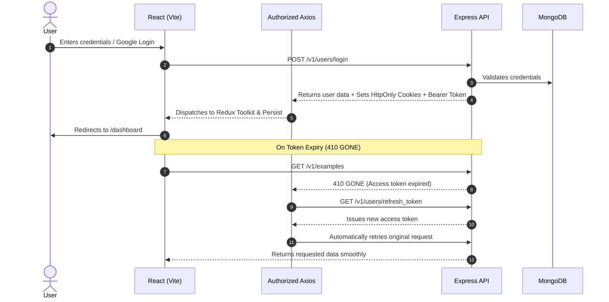

# ⚡ MERN Stack Frontend Boilerplate

[](https://react.dev/)
[](https://vitejs.dev/)
[](https://mui.com/)
[](https://redux-toolkit.js.org/)
[](https://socket.io/)
[](LICENSE)

A production-grade, enterprise-ready **MERN Stack Frontend Boilerplate** powered by React 18, Vite, Material UI (MUI v5), Redux Toolkit, Redux Persist, and Socket.IO.

Designed to pair seamlessly with [`mern-boilerplate-be`](https://github.com/duycuongdev/MERN_BOILERPLATE-BE.git) with pre-configured Dual-Authentication, automatic token rotation, dark/light theme switching, and modular CRUD blueprints.

---

## 🌟 Key Architecture & Features

### 🔐 1. Dual-Authentication & Smart Axios Interceptors
- **Universal Dual-Auth Engine:** Works effortlessly across both desktop browsers (using secure `HttpOnly` cookies) and mobile browsers/WebViews (via `Authorization: Bearer <token>` header).
- **Silent Refresh Token Queue:** When access tokens expire (`410 GONE`), Axios automatically queues incoming requests, issues a silent token refresh, updates Redux store, and transparently retries all pending API calls without interrupting the user.
- **Centralized Error Toasting:** API error responses (400, 403, 404, 500) automatically trigger compact, non-intrusive toast notifications with duplicate message prevention.
- **Google OAuth 2.0:** Integrated Google 1-Tap & credential button flow via `@react-oauth/google`.
- **Anti-Spam Click Throttling:** `interceptorLoadingElements` automatically prevents multi-clicks on submit buttons while requests are in flight.

### 🎨 2. Material UI v5 with Dual Theme Engine
- **Light & Dark Theme Engine:** Built on `@mui/material/styles` `Experimental_CssVarsProvider` for zero-flicker theme switches and automatic system preference detection.
- **Custom Design System:** Pre-styled buttons, cards, text fields, and custom slim scrollbars.
- **Material-UI Confirm:** Promise-based modal dialogs for delete confirmations and critical user prompts.

### 📦 3. State Management with Redux Toolkit & Persist
- **Redux Toolkit 2.0:** Slices configured with `createAsyncThunk` for scalable asynchronous data workflows.
- **Redux Persist:** Secure local storage persistence whitelisted to user authentication state, maintaining session continuity on page refreshes.
- **Session Focus Validation:** Proactively re-verifies session validity when the browser window regains focus or transitions routes.

### ⚡ 4. Real-Time WebSockets (Socket.IO)
- Configured Socket.IO client instance with automatic reconnection.
- Listens for private user events (`BE_RECEIVE_NOTIFICATION`) and personal room subscriptions.

### 📋 5. Interactive Blueprint Dashboard & CRUD
- **User Session Card:** Real-time visibility into active authenticated user details and socket connection.
- **Complete CRUD Module:** Create, Read (with search debounce & server pagination), Edit, and Soft-Delete items with instant UI updates.
- **Profile & Security Settings:** Avatar upload to Cloudinary via multipart form data, display name updates, and password rotation.

---

## 📁 Project Structure

```text
mern-boilerplate-fe/
├── public/                      # Static assets & favicons
├── src/
│   ├── apis/                    # Centralized API service methods
│   │   └── index.js             # User auth, refresh token & CRUD endpoints
│   ├── assets/                  # Images, SVGs and brand illustrations
│   ├── components/              # Reusable UI components
│   │   ├── AppBar/              # Responsive navigation header
│   │   │   ├── Menus/Profile.jsx# User avatar dropdown menu
│   │   │   └── AppBar.jsx       # Top navigation bar
│   │   ├── Form/                # Form validation helpers
│   │   │   ├── FieldErrorAlert.jsx
│   │   │   ├── ToggleFocusInput.jsx
│   │   │   └── VisuallyHiddenInput.jsx
│   │   ├── Icons/LogoIcon.jsx   # Vector logo icon
│   │   ├── Loading/PageLoadingSpinner.jsx
│   │   └── ModeSelect/ModeSelect.jsx # Dark/Light/System theme selector
│   ├── CustomHooks/             # Custom React hooks
│   │   └── useDebounceFn.js     # Debounce hook for instant search queries
│   ├── pages/                   # Application page views
│   │   ├── 404/NotFound.jsx     # 404 page
│   │   ├── Auth/                # Authentication views
│   │   │   ├── AccountVerification.jsx # Email verification landing page
│   │   │   ├── Auth.jsx         # Auth card container
│   │   │   ├── LoginForm.jsx    # Email/password & Google login
│   │   │   └── RegisterForm.jsx # Registration form
│   │   ├── Dashboard/Dashboard.jsx # Protected dashboard with live CRUD & socket test
│   │   ├── Home/Home.jsx        # Landing page with architectural highlights
│   │   └── Settings/            # User account settings
│   │       ├── AccountTab.jsx   # Profile & Cloudinary avatar uploader
│   │       ├── SecurityTab.jsx  # Password update form
│   │       └── Settings.jsx     # Tabbed settings view
│   ├── redux/                   # Redux Toolkit state management
│   │   ├── example/exampleSlice.js # CRUD resource state slice
│   │   ├── user/userSlice.js    # Authentication & user profile slice
│   │   └── store.js             # Root store with redux-persist configuration
│   ├── sockets/                 # Socket.IO client instance
│   │   └── socketClient.js
│   ├── utils/                   # Utilities & configurations
│   │   ├── authorizeAxios.js    # Axios instance with interceptors & token refresh
│   │   ├── constants.js         # API root & pagination defaults
│   │   ├── formatter.js         # Helper functions
│   │   └── validators.js        # Regex rules & file validators
│   ├── App.jsx                  # React Router routes & ProtectedRoute guard
│   ├── main.jsx                 # Application entry point with providers
│   └── theme.js                 # MUI theme colors, typography & component overrides
├── .eslintrc.cjs                # ESLint code linting rules
├── .gitignore                   # Git ignore patterns
├── index.html                   # HTML template
├── package.json                 # Dependencies & scripts
├── vite.config.js               # Vite configuration & path aliases (~/*)
├── .env.example                 # Environment variables template
└── README.md                    # Project documentation
```

---

## ⚙️ Environment Configuration

Create a `.env` file in the root directory by copying `.env.example`:

```bash
cp .env.example .env
```

| Variable | Description | Default / Example |
| :--- | :--- | :--- |
| `VITE_API_ROOT` | Backend API base URL | `http://localhost:8017` (Dev) |
| `VITE_GOOGLE_CLIENT_ID` | Google OAuth Web Client ID | Retrieved from Google Cloud Console |

---

## 🚀 Getting Started

### 1. Install Dependencies
```bash
npm install
```

### 2. Start Local Development Server
```bash
npm run dev
```
Open your browser and navigate to:
`http://localhost:5173`

### 3. Build & Preview for Production
```bash
# Build optimized production bundle to dist/
npm run build

# Preview production build locally
npm run preview
```

---

## 🔒 Authentication Flow Overview



---

## 🛠️ Verification & Quality Checks

Run lint checks and production compilation:
```bash
npm run lint
npm run build
```

---

## 📄 License
This project is open-source and available under the [MIT License](LICENSE).
Created with ❤️ by [Duy Cuong](https://github.com/duycuongdev).

